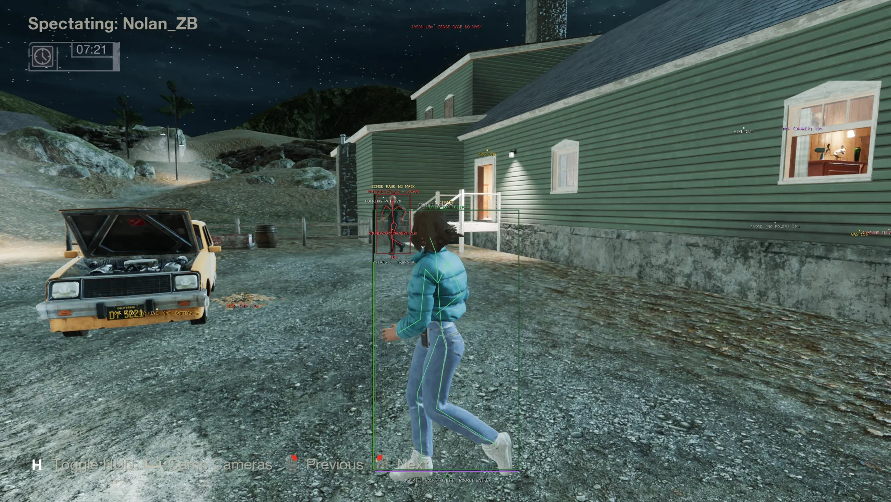
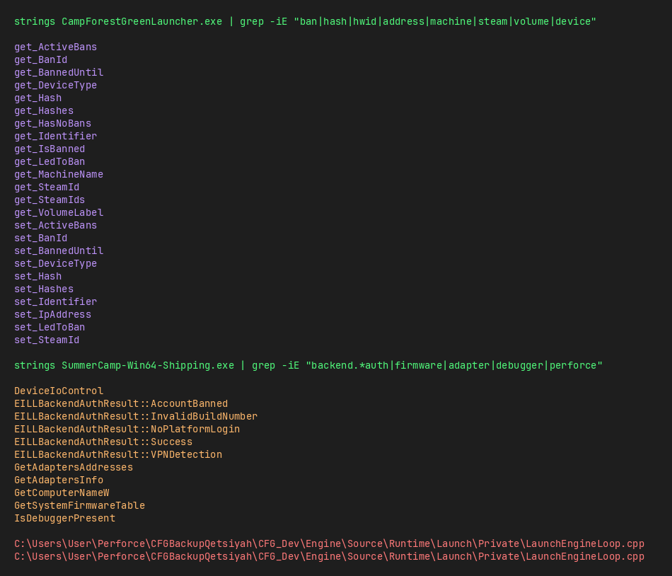

# wine-spoof

hwid spoofer for wine/proton prefixes. run it before launching and your ban is gone.

Nice anticheat bro 🤣



## what it spoofs

- MachineGuid and ComputerName (wine registry)
- VolumeLabel and drive serial (wine C: drive)
- MAC address
- DMI board serial, product UUID, product serial (bind-mounted over sysfs)
- Sentry installation IDs (auto-found in prefix)
- UE4/UE5 crash and log caches

## usage

```
sudo ./spoof.sh /path/to/wine/prefix [interface]
```

first arg is your prefix (where `system.reg` lives), second is your network interface (default `eno1`). needs sudo for MAC and DMI bind mounts. you probably want a VPN too since most bans are also IP-based.

## thanks

shoutout to the CFG dev that told me "good luck" and called me a skid. you didnt even XOR your strings bro. Your .NET app has every symbol there, and your anticheat minhooks its own functions.



also shoutout to the 3 mods that banned me for a rule that doesnt exist, lied about the reason, and then blocked me when i asked for proof.

## Written by Ring0 (Discord: process_vm_writev)
